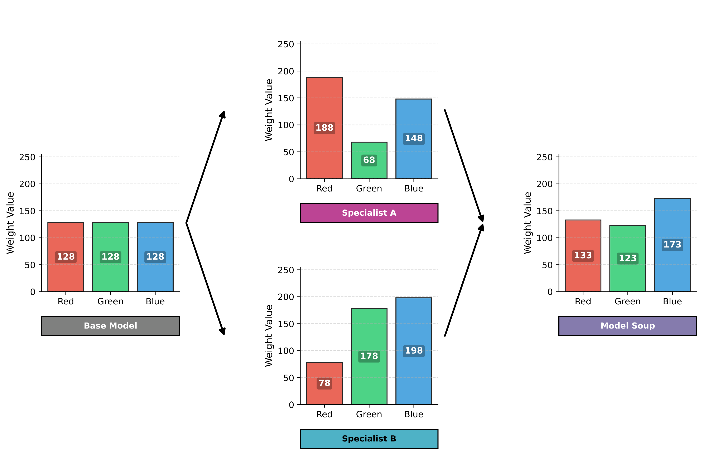
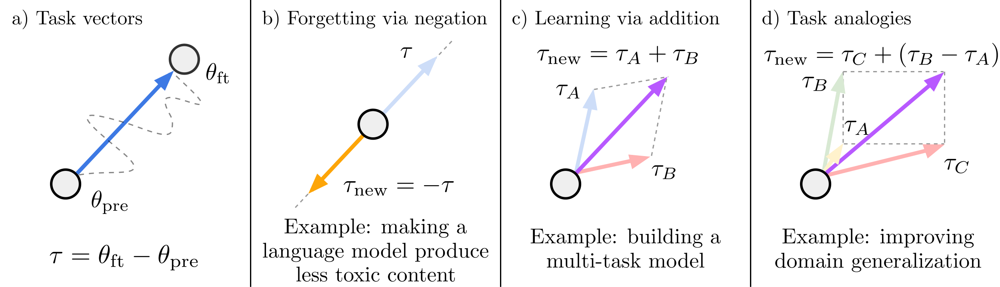
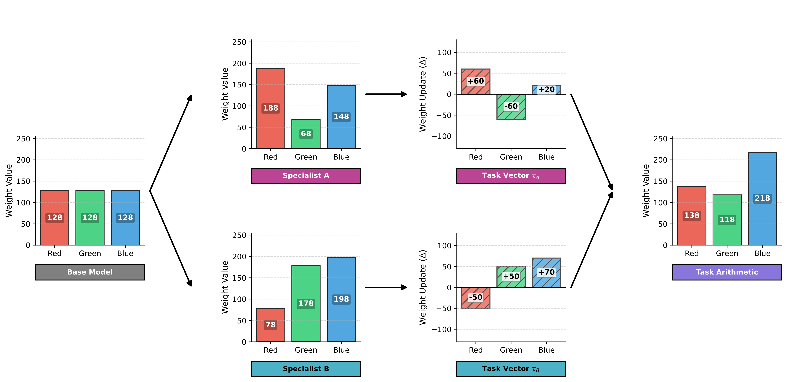
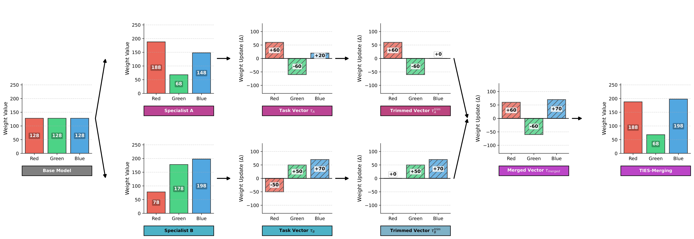
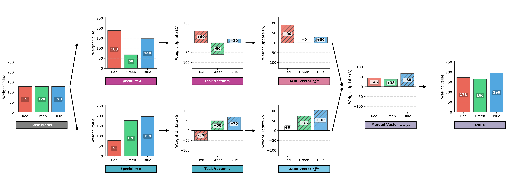
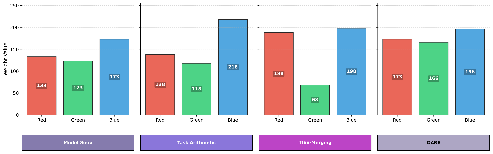
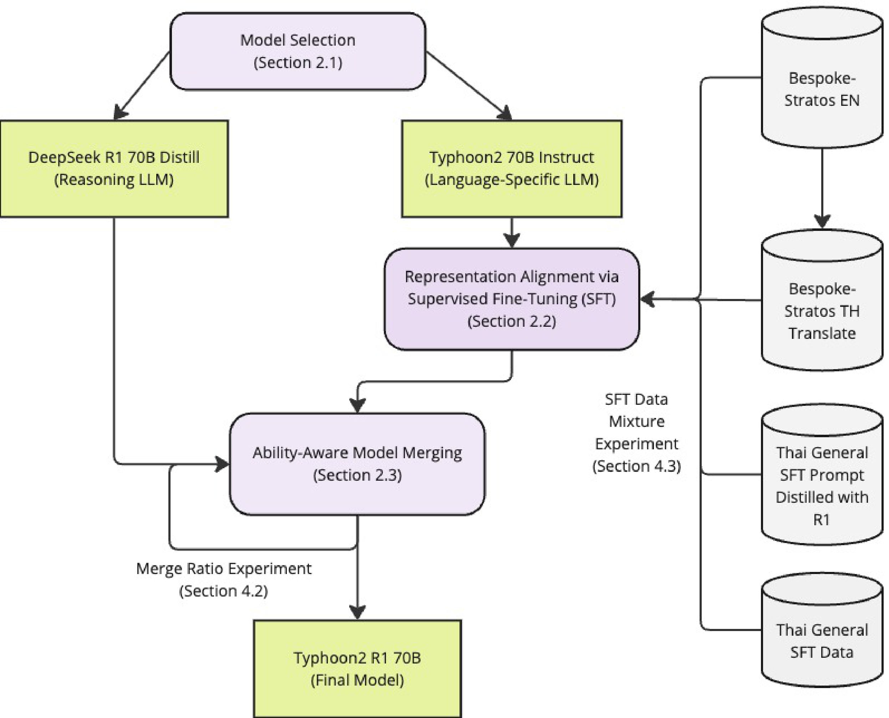

import { Image } from 'astro:assets';
import toyStructureImg from './network_toy_structure.png';
import toyBarsImg from './network_toy_bars.png';

## 1. The Core Idea and Our 3-Weight Toy Network

Normally, combining two specialized models means either running both side-by-side at inference time (ensembling, which doubles memory and latency) or collecting all their datasets to run a costly multi-task fine-tuning job.

**Model Merging** offers a shortcut: if two specialists were fine-tuned from the **same pre-trained checkpoint**, their weights stay close enough in the loss landscape that you can directly combine their numbers in weight space.

To see what each merging recipe actually does under the hood, forget billions of parameters for a moment. Picture a tiny neural network with three inputs ($x_1, x_2, x_3$), one output ($y$), and just three learnable weights ($w_1, w_2, w_3$):

  <figure class="m-0">
    <Image src={toyStructureImg} alt="Three-weight toy neural network mapping inputs x1, x2, x3 through weights w1, w2, w3 to output y" class="m-0 w-full bg-white" />
    <figcaption class="text-center text-xs text-neutral-500 dark:text-neutral-400 mt-2">Our 3-weight toy network (w1, w2, w3).</figcaption>
  </figure>
  <figure class="m-0">
    <Image src={toyBarsImg} alt="RGB bar chart for weights [188, 68, 148] producing a blended magenta color swatch" class="m-0 w-full bg-white" />
    <figcaption class="text-center text-xs text-neutral-500 dark:text-neutral-400 mt-2">Weights plotted as Red, Green, and Blue values (0–255).</figcaption>
  </figure>

By mapping `[w1, w2, w3]` to **Red, Green, and Blue (`0–255`)**, every checkpoint becomes a color:

- **Base Model ($\theta_{\text{pre}}$):** A neutral gray `[128, 128, 128]`.
- **Specialist A (Pink/Magenta):** Fine-tuned to `[188, 68, 148]`, shifting the base by `[+60, -60, +20]`.
- **Specialist B (Cyan):** Fine-tuned to `[78, 178, 198]`, shifting the base by `[-50, +50, +70]`.

Now let's watch what happens when four popular algorithms merge Specialist A and Specialist B.

---

## 2. How Different Merging Algorithms Work

### 2.1. Model Soups (Simple Weight Averaging)

**Model Soups** (Wortsman et al., 2022) averages the weights of $k$ fine-tuned checkpoints element by element:

$$
\theta_{\text{soup}} = \frac{1}{k} \sum_{i=1}^{k} \theta_i
$$

Originally introduced to combine runs trained with different hyperparameters on one task, **Model Fusion** (Choshen et al., 2022) showed that averaging checkpoints from different tasks also builds a solid generalist starting point.

Look at the bars above: averaging `[188, 68, 148]` and `[78, 178, 198]` produces `[133, 123, 173]`. Because Specialist A pushes Red up and Green down while Specialist B does the exact opposite, taking the plain average washes both channels back toward gray (`128`).

### 2.2. Task Arithmetic

Instead of averaging raw checkpoints, **Task Arithmetic** (Ilharco et al., 2023) subtracts the original base model $\theta_{\text{pre}}$ from a fine-tuned checkpoint $\theta_{\text{ft}}^t$ to isolate what training changed—called a **task vector** $\tau_t$:

$$
\tau_t = \theta_{\text{ft}}^t - \theta_{\text{pre}}
$$

You can then add skills together, negate a vector to erase an unwanted behavior, or build task analogies, scaling the total change with a factor $\lambda \ge 0$:

$$
\theta_{\text{new}} = \theta_{\text{pre}} + \lambda \sum_{t} \tau_t
$$

Applying Task Arithmetic ($\lambda = 1$) to our toy checkpoints adds both deltas straight onto `[128, 128, 128]`:

Blue gets a strong boost (`+20 + 70 = +90`, reaching `218`) because both specialists agree on increasing it. Still, Red (`+60 - 50 = +10`) and Green (`-60 + 50 = -10`) partially cancel each other out.

### 2.3. TIES-Merging (Trim, Elect Sign, and Merge)

Yadav et al. (2023) showed that summing task vectors degrades when two things collide: tiny noisy changes accumulated across many parameters, and opposing signs pulling the same weight in opposite directions.

**TIES-Merging** cleans up those collisions in three stages:

1. **Trim:** Keep only the largest-magnitude entries in each task vector (top fraction $\rho$) and zero out minor fluctuations.
2. **Elect Sign:** Sum the remaining values per weight and pick whichever sign (`+` or `-`) has the greater total magnitude: $\gamma_m^p = \text{sgn}\left(\sum_{t=1}^n \hat{\tau}_t^p\right)$.
3. **Disjoint Merge:** Average *only* the non-zero updates that agree with that winning sign, ignoring dissenting ones, then add the scaled result back to $\theta_{\text{pre}}$.

Watch how TIES handles our toy example: trimming zeroes out Specialist A's small `+20` Blue delta and Specialist B's `-50` Red delta. Next, Green sees `-60` vs. `+50`, so `-` wins and `+50` is dropped from the average. The result (`[188, 68, 198]`) keeps every strong specialist feature crisp instead of muddying them.

### 2.4. DARE (Drop and Rescale)

**DARE** (Yu et al., 2024) starts from a striking finding about Supervised Fine-Tuning (SFT): most weight deltas created during SFT are redundant. You can randomly erase `90%` to `99%` of those changes without losing the specialist's skill, as long as you scale up what survives.

It works as a two-step filter before merging:

1. **Drop:** Randomly discard each delta coordinate with probability $p \in [0, 1)$ via a Bernoulli mask $m_i^t \sim \text{Bernoulli}(p)$:

$$
\tilde{\tau}_{t, i} = (1 - m_i^t) \cdot \tau_{t, i}
$$

2. **Rescale:** Divide the surviving deltas by $1 - p$ so the expected value stays unchanged:

$$
\hat{\tau}_{t, i} = \frac{\tilde{\tau}_{t, i}}{1 - p} \implies \mathbb{E}[\hat{\tau}_{t, i}] = \tau_{t, i}
$$

Because nearly all deltas are set to zero, two specialists rarely touch the same weight at the same time—giving `[173, 166, 196]` with minimal overlap.

### 2.5. Side-by-Side Comparison

| Algorithm | Core Idea | Conflict Strategy |
| :--- | :--- | :--- |
| **Model Soups** | Averages raw model weights equally | None; opposing shifts dilute each other |
| **Task Arithmetic** | Adds/subtracts delta vectors ($\tau_t$) | Global scaling ($\lambda$), no conflict filtering |
| **TIES-Merging** | Trims noise, votes on sign, disjoint mean | Discards weak deltas and minority-sign updates |
| **DARE** | Randomly drops deltas ($p$) and rescales by $\frac{1}{1-p}$ | Extreme sparsity prevents weights from colliding |

> **Engineering Tip:** Because DARE only sparsifies task vectors, libraries like **MergeKit** (Goddard et al., 2025) let you pair it with Task Arithmetic (`dare_linear`) or TIES (`dare_ties`) when combining several models at once.

---

## 3. Case Study: Teaching Reasoning to a Local-Language LLM

Can merging transfer complex skills across languages without full retraining? Pipatanakul et al. (2025) built **Typhoon-R1** by combining two 70B models sharing the same backbone: **DeepSeek-R1 70B Distill** (strong at math and logic, but prone to switching into English or Chinese mid-answer) and **Typhoon2 70B Instruct** (fluent in Thai, but weaker on hard reasoning).

Their workflow took just two stages:

1. **Quick Alignment via SFT:** Independently trained models can drift apart internally. Running lightweight SFT on `24,000` mixed English/Thai reasoning examples brought Typhoon2's internal representations into sync with DeepSeek-R1.
2. **Layer-by-Layer Merging (DARE-linear):** Instead of one fixed ratio everywhere, early and middle transformer layers (where abstract problem-solving happens) received `75%` weight from DeepSeek-R1, while later layers (which control local phrasing and output tokens) shifted linearly up to `87.5%` weight on Typhoon2.

When target-language reasoning examples are scarce, alignment plus layer-wise merging outperforms fine-tuning alone—borrowing pre-trained reasoning circuits while preserving native fluency.

---

## 4. Active Recall Quiz

<Quiz
  title="Check Your Understanding"
  questions={[
    {
      question: "Why does simple averaging (**Model Soups**) usually fail on random checkpoints, yet work well when fine-tuned from the **same base model**—and what still goes wrong when tasks conflict?",
      options: [
        "Random checkpoints work fine too, because neural loss surfaces are convex, though merging doubles inference memory.",
        "Shared-base checkpoints stay in the same low-error region so averaging keeps inference cost flat, but opposing weight shifts still dilute each other.",
        "Model Soups randomly zeroes out 90% of weights before averaging, eliminating any overlap.",
        "Model Soups requires completely independent pre-training seeds to prevent overfitting.",
      ],
      correctIndex: 1,
      explanation: "Sharing a starting checkpoint keeps fine-tuned weights in a compatible region of the loss landscape without adding inference latency. Still, if Specialist A increases a weight and Specialist B decreases it, plain averaging partially cancels both changes.",
    },
    {
      question: "How does **TIES-Merging** prevent a small opposing update from dragging down a strong specialist update on the same parameter?",
      options: [
        "It clips every averaged weight to stay inside the base model's min/max range.",
        "It multiplies every delta vector by a random Bernoulli mask and scales by $\\frac{1}{1-p}$.",
        "After dropping low-magnitude deltas, it picks the sign with the larger total magnitude and averages only the non-zero updates matching that sign.",
        "It freezes all attention layers and only averages the final embedding matrix.",
      ],
      correctIndex: 2,
      explanation: "TIES uses three steps: **Trim** zeroes out small noisy updates, **Elect Sign** chooses the direction with higher aggregate magnitude ($\\text{sgn}(\\sum \\hat{\\tau}_t^p)$), and **Disjoint Merge** averages only updates that agree with that winning direction.",
    },
    {
      question: "Why does **DARE** scale surviving delta values by $\\frac{1}{1-p}$ after randomly zeroing out a fraction $p$ of them?",
      options: [
        "To preserve the expected delta update ($\\mathbb{E}[\\hat{\\tau}_{t,i}] = \\tau_{t,i}$) so layer activations do not drift out of scale.",
        "To ensure every weight change becomes strictly positive before Task Arithmetic addition.",
        "To cut the number of floating-point operations during inference by a factor of $p$.",
        "To pin the L2 norm of the merged model to the exact norm of the pre-trained base model.",
      ],
      correctIndex: 0,
      explanation: "Dropping `90%–99%` of deltas without rescaling shrinks activation magnitudes across layers and breaks output quality. Dividing active deltas by $1-p$ keeps the mathematical expectation unbiased.",
    },
    {
      question: "In the **Typhoon-R1** recipe, why are early/middle layers weighted toward DeepSeek-R1 while final layers are weighted toward Typhoon2?",
      options: [
        "Early layers hold fewer weights, so giving them 75% DeepSeek-R1 reduces GPU VRAM usage.",
        "Early and middle layers drive abstract reasoning, whereas later layers handle local-language fluency and token generation.",
        "Final transformer layers have incompatible tensor dimensions across the two models.",
        "Weighting early layers toward Typhoon2 forces the model to reason exclusively in English.",
      ],
      correctIndex: 1,
      explanation: "In ability-aware merging, early/middle blocks carry `75%` DeepSeek-R1 weight to keep logical reasoning intact, while the final layers ramp up to `87.5%` Typhoon2 weight so output tokens remain fluent in Thai.",
    },
  ]}
/>

---

## 5. References

- **Goddard et al. (2025):** Goddard, C., Siriwardhana, S., Ehghaghi, M., Meyers, L., Karpukhin, V., Benedict, B., McQuade, M., & Solawetz, J. *Arcee's MergeKit: A Toolkit for Merging Large Language Models*. arXiv:2403.13257. [https://arxiv.org/abs/2403.13257](https://arxiv.org/abs/2403.13257)
- **Wortsman et al. (2022):** Wortsman, M., Ilharco, G., Gadre, S. Y., Roelofs, R., Gontijo-Lopes, R., Morcos, A. S., Namkoong, H., Farhadi, A., Carmon, Y., Kornblith, S., & Schmidt, L. *Model soups: averaging weights of multiple fine-tuned models improves accuracy without increasing inference time*. arXiv:2203.05482. [https://arxiv.org/abs/2203.05482](https://arxiv.org/abs/2203.05482)
- **Choshen et al. (2022):** Choshen, L., Venezian, E., Slonim, N., & Katz, Y. *Fusing finetuned models for better pretraining*. arXiv:2204.03044. [https://arxiv.org/abs/2204.03044](https://arxiv.org/abs/2204.03044)
- **Ilharco et al. (2023):** Ilharco, G., Ribeiro, M. T., Wortsman, M., Gururangan, S., Schmidt, L., Hajishirzi, H., & Farhadi, A. *Editing Models with Task Arithmetic*. arXiv:2212.04089. [https://arxiv.org/abs/2212.04089](https://arxiv.org/abs/2212.04089)
- **Yadav et al. (2023):** Yadav, P., Tam, D., Choshen, L., Raffel, C., & Bansal, M. *TIES-Merging: Resolving Interference When Merging Models*. arXiv:2306.01708. [https://arxiv.org/abs/2306.01708](https://arxiv.org/abs/2306.01708)
- **Yu et al. (2024):** Yu, L., Yu, B., Yu, H., Huang, F., & Li, Y. *Language Models are Super Mario: Absorbing Abilities from Homologous Models as a Free Lunch*. arXiv:2311.03099. [https://arxiv.org/abs/2311.03099](https://arxiv.org/abs/2311.03099)
- **Pipatanakul et al. (2025):** Pipatanakul, K., Taveekitworachai, P., Manakul, P., & Tharnpipitchai, K. *Adapting Language-Specific LLMs to a Reasoning Model in One Day via Model Merging -- An Open Recipe*. arXiv:2502.09056. [https://arxiv.org/abs/2502.09056](https://arxiv.org/abs/2502.09056)
